<!-- SPDX-FileCopyrightText: 2026 Junctura Contributors -->
<!-- SPDX-License-Identifier: Apache-2.0 -->

<div align="center">


# Junctura Clinic

**Phần mềm nguồn mở cho trạm y tế xã — tiếp đón, khám, tiêm chủng, chuyển tuyến, và chỉ chia sẻ hồ sơ khi người bệnh đồng ý.**

[](https://github.com/vku2-open-source-2026/junctura-clinic/actions/workflows/ci.yml)
[](LICENSE)
[](REUSE.toml)


[Giới thiệu](#giới-thiệu) · [Giao diện](#giao-diện) · [Kiến trúc](#kiến-trúc) · [Bắt đầu nhanh](#bắt-đầu-nhanh) · [Cấu hình](#cấu-hình) · [Trang và API](#trang-và-api-chính) · [Tài liệu](#tài-liệu) · [Lộ trình](#lộ-trình)

</div>

---

## Giới thiệu

Trạm y tế xã là nơi người dân gặp nhân viên y tế đầu tiên, nhưng phần mềm thường tách rời: sổ giấy ở quầy, một file riêng cho tiêm chủng, giấy chuyển tuyến viết tay. Khi người bệnh lên bệnh viện, hồ sơ phải hỏi lại từ đầu; khi chia sẻ thì dễ chia sẻ nhiều hơn mức cần thiết.

**Junctura Clinic** là ứng dụng trạm y tế trong [Junctura Health](https://github.com/vku2-open-source-2026/junctura-health), Tầng 2 của [Junctura DX-OS](https://github.com/vku2-open-source-2026/junctura-dxos). Clinic giải quyết bài toán theo hai phần:

- **Việc hằng ngày của trạm** — tiếp đón, hàng chờ, khám, kê đơn, tiêm chủng, chuyển tuyến, báo cáo, trong một giao diện dùng được trên điện thoại.
- **Chia sẻ có kiểm soát** — trạm giữ hồ sơ của chính mình. Bệnh viện hoặc nhà thuốc cần dữ liệu thì **hỏi qua Junctura**; Clinic chỉ trả lời khi người bệnh đã đồng ý, đúng mục đích, và chỉ với phần cần thiết. Mọi lần hỏi đều để lại dấu vết.

> Đây là sản phẩm demo cho cuộc thi; dữ liệu là **dữ liệu giả lập**, không có thông tin người thật.

### Ai dùng và dùng để làm gì

| Vai trò | Việc chính |
| --- | --- |
| **Nhân viên tiếp đón** (`clinic-reception`) | Tìm hoặc tạo hồ sơ, ghi mã BHYT, đưa người vào hàng chờ, gọi số |
| **Y sĩ, bác sĩ** (`clinic-staff`) | Khám, kê đơn, ghi tiêm chủng, lập phiếu chuyển tuyến |
| **Quản lý trạm** (`clinic-manager`) | Xem báo cáo, nhật ký, quản lý điểm khám, bật tắt tóm tắt AI |
| **Người dân** | Quét mã QR lấy số, xem số đang gọi trên màn hình chờ |
| **Bệnh viện, nhà thuốc** | Hỏi dữ liệu của trạm qua Junctura (không đăng nhập vào Clinic) |

## Tính năng nổi bật

**Tiếp đón và hàng chờ**
- Hàng chờ theo ngày, số thứ tự từ 001, ưu tiên khẩn, gọi khám, hủy lượt; có cảnh báo trùng khi tạo hồ sơ mới.
- Trẻ dưới 6 tuổi và người từ 60 tuổi tự được xếp ưu tiên; ghi và sửa mã BHYT.
- Người dân lấy số bằng mã QR (`/lay-so`): chỉ cấp khi họ tên và năm sinh khớp đúng một hồ sơ, và chỉ trả về số thứ tự.
- Màn hình chờ (`/bang-so`) chỉ hiện số, không hiện tên.
- Nhiều điểm khám trong một trạm, mỗi điểm có hàng chờ riêng.

**Khám, tiêm chủng, chuyển tuyến**
- Hồ sơ tìm không cần gõ dấu, lọc theo nhóm (có dị ứng, cao tuổi, trẻ nhỏ); thanh dị ứng luôn ở đầu hồ sơ.
- Khám: lý do, sinh hiệu, chẩn đoán, đơn thuốc, dặn dò; gợi ý mã ICD-10 và tên thuốc (danh sách ngắn phục vụ demo, **không** phải tài liệu tra cứu thuốc).
- Thuốc trùng nhóm với dị ứng đã ghi nhận bị chặn, chỉ vượt được khi nhập lý do.
- Tiêm chủng: tự tính số mũi, chặn tiêm trùng hoặc đủ mũi, danh sách nhắc tiêm toàn trạm.
- Chuyển tuyến: lập phiếu, xem, in; theo dõi trạng thái và biết **bệnh viện đã xem phiếu qua Junctura chưa, mấy lần, lúc nào**.

**Chia sẻ qua Junctura**
- Cung cấp bốn năng lực theo hợp đồng dùng chung (`pre-visit-summary`, `allergy-list`, `vaccination-history`, `referral-summary`).
- Danh sách dị ứng rỗng luôn là "chưa ghi nhận", không bao giờ là "không dị ứng" (trường `allergyState`).
- "Nhật ký Junctura": mỗi lần ứng dụng khác xin dữ liệu — năng lực nào, mục đích, có khẩn cấp không, hồ sơ nào, đã trả lời hay bị từ chối và vì sao.

**Quản lý**
- Báo cáo số ca theo ngày, nhóm bệnh, phường/xã, nhóm tuổi, tiêm chủng; chỉ là số đếm, không có tên; tải CSV mở đúng tiếng Việt trong Excel.
- Nhật ký thao tác: ai, lúc nào, làm gì, với hồ sơ nào (kể cả lượt xem), không chứa nội dung khám.
- Tóm tắt hồ sơ theo quy tắc cố định; **tùy chọn** dùng mô hình AI (tắt mặc định, dữ liệu gửi đi đã bỏ danh tính, kết quả luôn có nhãn "cần kiểm tra lại", lỗi thì quay về bản theo mẫu).
- Giao diện dựng trên [`@junctura/health-ui`](https://www.npmjs.com/package/@junctura/health-ui): sáng/tối, cỡ chữ, tìm nhanh (`/` hoặc Ctrl+K), dùng được trên điện thoại.

## Giao diện

Ảnh chụp từ bản demo với dữ liệu giả lập.

<table>
  <tr>
    <td width="50%">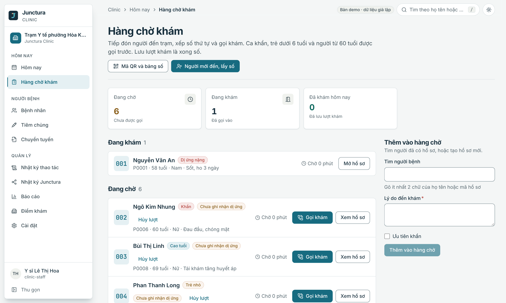<br><sub><b>Hàng chờ khám</b>: số thứ tự, ưu tiên khẩn, trẻ nhỏ, người cao tuổi</sub></td>
    <td width="50%">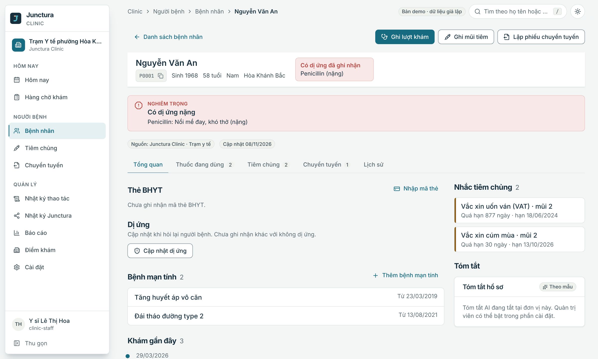<br><sub><b>Hồ sơ</b>: thanh dị ứng luôn ở đầu, thẻ BHYT, nhắc tiêm chủng</sub></td>
  </tr>
  <tr>
    <td width="50%">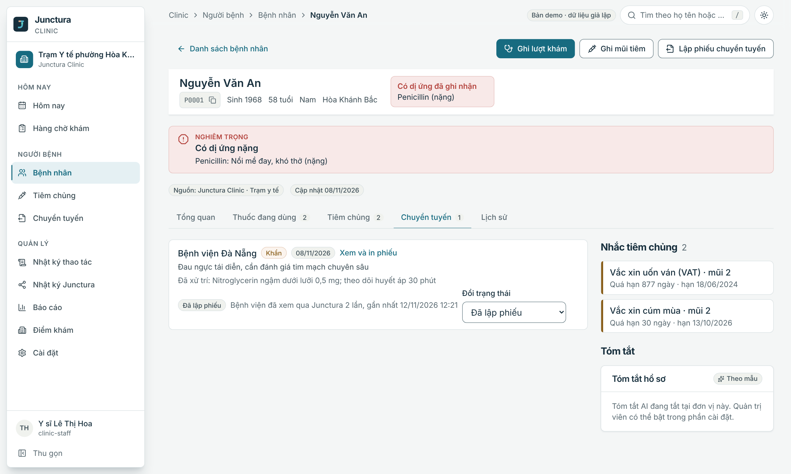<br><sub><b>Chuyển tuyến</b>: trạng thái và số lần bệnh viện đã xem qua Junctura</sub></td>
    <td width="50%">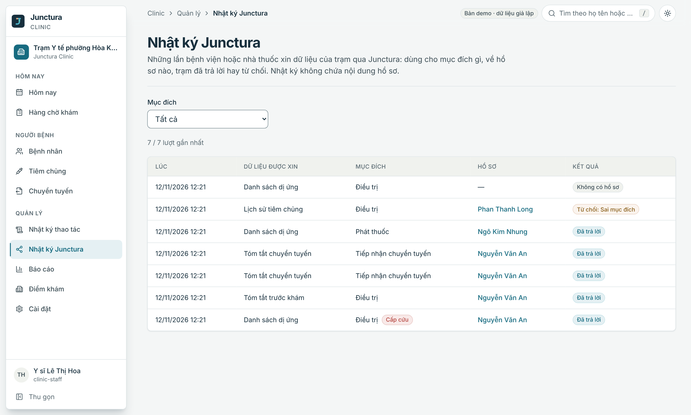<br><sub><b>Nhật ký Junctura</b>: ai xin dữ liệu gì, mục đích, kết quả</sub></td>
  </tr>
  <tr>
    <td width="50%">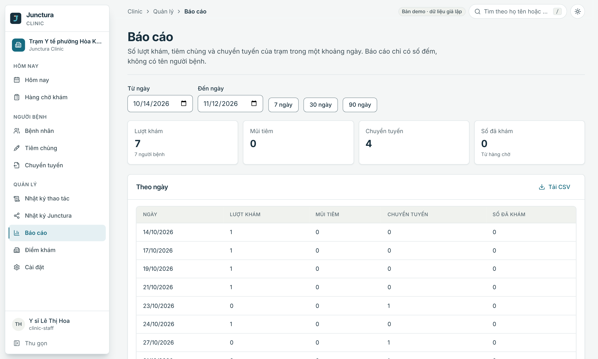<br><sub><b>Báo cáo</b>: chỉ số đếm, tải CSV</sub></td>
    <td width="50%">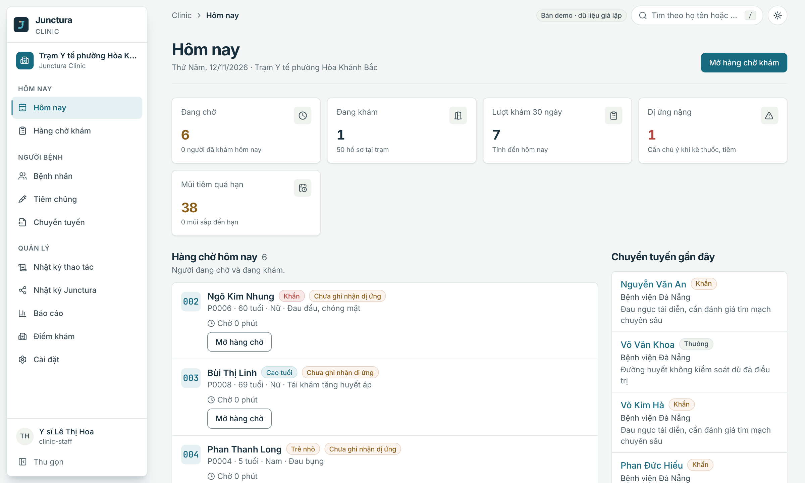<br><sub><b>Hôm nay</b>: việc cần xử lý trong ngày</sub></td>
  </tr>
</table>

**Lấy số tự phục vụ.** Người dân quét mã QR và nhận số thứ tự trên điện thoại; màn hình chờ ở trạm chỉ hiện số.

<table>
  <tr>
    <td width="25%">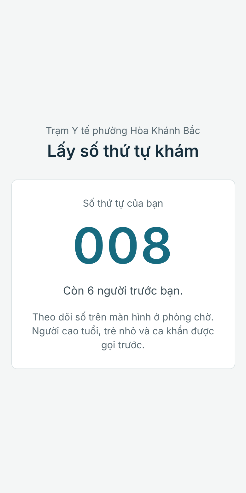</td>
    <td width="75%">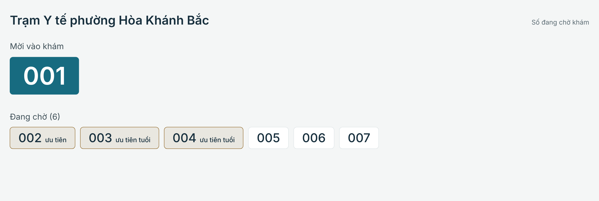</td>
  </tr>
</table>

## Kiến trúc

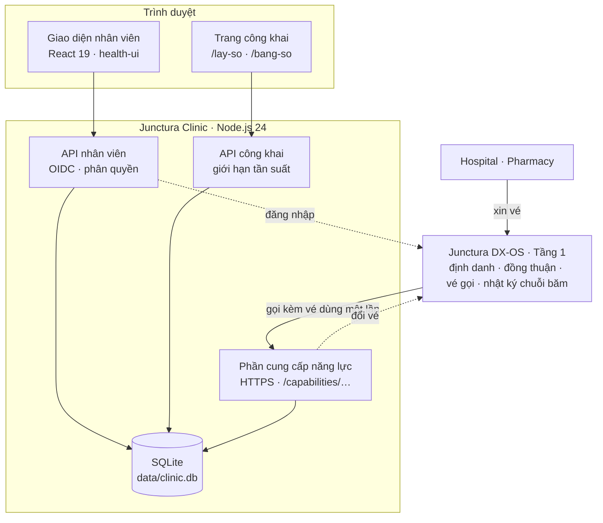

Clinic không gọi thẳng ứng dụng khác và không đọc cơ sở dữ liệu của ứng dụng khác; mọi trao đổi đi qua Junctura. Kho dữ liệu của Tầng 1 không hỗ trợ tìm kiếm, lọc nhiều tiêu chí và báo cáo, nên dữ liệu khám nằm trong SQLite cục bộ của trạm; Tầng 1 giữ định danh, đồng thuận và nhật ký chuỗi băm.

### Một lần Hospital xin dữ liệu diễn ra thế nào

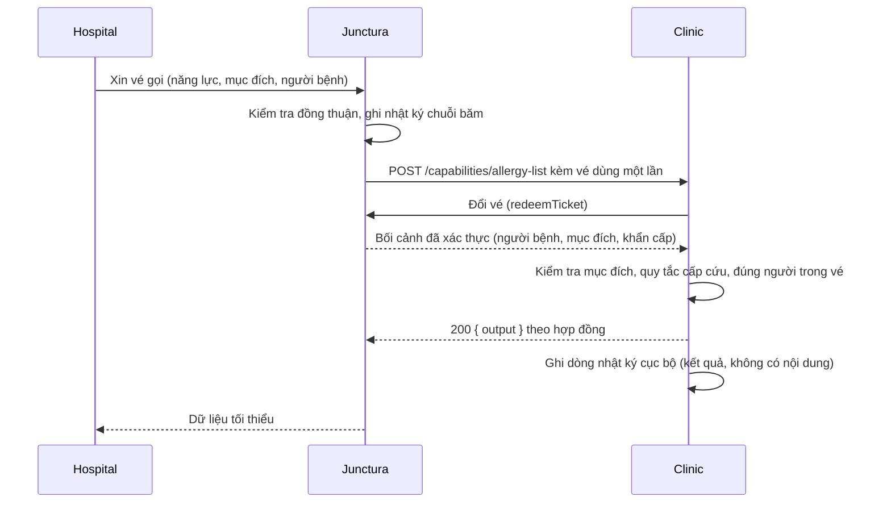

### Bốn năng lực Clinic cung cấp

Theo [hợp đồng dùng chung](https://github.com/vku2-open-source-2026/junctura-health/tree/main/contracts) (`@junctura/health-contracts` 1.1.0):

| Năng lực | Bên gọi | Mục đích | Cấp cứu |
| --- | --- | --- | --- |
| `pre-visit-summary` | Hospital | `treatment` | Có |
| `allergy-list` | Hospital, Pharmacy | `treatment`, `dispensing` | Có |
| `vaccination-history` | Hospital | `treatment` | Không |
| `referral-summary` | Hospital | `referral_intake` | Không |

Kết quả mỗi lần gọi là một trong: `answered`, `refused:<lý do>`, `no_record`, `data_error`.

### Vòng đời phiếu chuyển tuyến

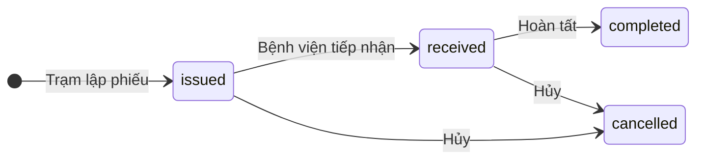

Số lần và thời điểm bệnh viện xem phiếu lấy từ nhật ký các lần Clinic đã trả lời `referral-summary`.

### Mô hình bảo mật

| Lớp | Cơ chế |
| --- | --- |
| Xác thực | Đăng nhập Junctura (OpenID Connect, PKCE); phiên ký RS256. Chỉ tài khoản có vai trò của trạm vào được; người khác nhận 403 |
| Phân quyền | Mỗi vai trò có danh sách quyền cố định; vai trò không có trong danh sách không có quyền nào, nên vai trò mới thêm vào hệ thống định danh không tự động đọc được dữ liệu |
| Chia sẻ dữ liệu | Chỉ trả lời khi vé hợp lệ, đúng mục đích, đúng người trong vé; mọi trường hợp khác bị từ chối và ghi lại lý do |
| Hiển thị an toàn | Dị ứng rỗng là "chưa ghi nhận"; thuốc trùng nhóm dị ứng bị chặn |
| Nhật ký | Nhật ký thao tác và nhật ký Junctura chỉ ghi ai, lúc nào, làm gì, với hồ sơ nào; không chứa nội dung khám |
| Trang công khai | `/lay-so`, `/bang-so` chỉ trả số thứ tự; cấp số cần họ tên và năm sinh khớp đúng một hồ sơ; giới hạn tần suất; chỉ cho người đã có hồ sơ |
| AI (tùy chọn) | Tắt mặc định; chỉ gửi dữ liệu đã bỏ tên, số điện thoại, địa chỉ, mã hồ sơ, ngày sinh; chỉ nhận địa chỉ `https` hoặc `localhost`; kết quả có nhãn kiểm tra lại |
| Bí mật | Khóa và mật khẩu nằm trong biến môi trường hoặc file `.env` (đã loại khỏi git); không có bí mật trong mã nguồn |

### Phân quyền theo vai trò

| Quyền | `clinic-staff` | `clinic-manager` | `clinic-reception` |
| --- | :---: | :---: | :---: |
| Xem hồ sơ (`read`), đăng ký người mới (`register`), quản lý hàng chờ (`queue`) | ✅ | ✅ | ✅ |
| Khám (`exam`), tiêm chủng (`vaccinate`), chuyển tuyến (`refer`) | ✅ | ✅ | |
| Nhật ký (`audit.read`), báo cáo (`report`), cài đặt và điểm khám (`settings.write`) | ✅ | ✅ | |

## Bắt đầu nhanh

**Yêu cầu:** Git, Node.js 24 (xem `.node-version`). Chạy đủ cả hệ thống cần thêm Docker, [junctura-dxos](https://github.com/vku2-open-source-2026/junctura-dxos) đang chạy (`npm run local:up`) và [junctura-health](https://github.com/vku2-open-source-2026/junctura-health) đã chạy `npm run demo:setup`. Hai repo này nằm cạnh thư mục Clinic; nếu ở nơi khác, đặt `JUNCTURA_HEALTH_DIR`.

```sh
git clone https://github.com/vku2-open-source-2026/junctura-clinic.git
cd junctura-clinic
npm ci                # cài thư viện máy chủ từ lockfile
npm run web:install   # cài thư viện giao diện từ lockfile
npm run build         # build giao diện vào web/dist
npm start             # chạy máy chủ
```

Hoặc dùng bản phát hành: tải `junctura-clinic-0.1.0.tar.gz` và `junctura-clinic-0.1.0.tar.gz.sha256` từ [Releases](https://github.com/vku2-open-source-2026/junctura-clinic/releases), kiểm tra bằng `sha256sum -c junctura-clinic-0.1.0.tar.gz.sha256`, giải nén (`tar -xzf junctura-clinic-0.1.0.tar.gz`), vào thư mục `junctura-clinic-0.1.0` rồi chạy các lệnh trên từ `npm ci`.

Mở <http://localhost:5181> và đăng nhập bằng `ysi.tramyte`. Mật khẩu demo nằm trong `.junctura/demo/accounts.env` của junctura-health.

**Lấy số bằng điện thoại.** Đặt `HOST=0.0.0.0`, mở Clinic bằng địa chỉ mạng nội bộ của máy (ví dụ `http://192.168.1.10:5181`), vào **Hàng chờ → QR** rồi quét. Mã QR dùng đúng địa chỉ đang mở.

**Chạy bằng Docker.** Cần Docker, Junctura DX-OS đang chạy ở máy bạn (`npm run local:up`) và junctura-health đã chạy `demo:setup`:

```sh
docker compose up --build
```

Mở <http://localhost:5181>. Compose dựng ảnh từ [`Dockerfile`](Dockerfile) (build nhiều giai đoạn, chạy bằng người dùng không phải root), gắn thư mục junctura-health ở chế độ chỉ đọc và lưu cơ sở dữ liệu trong volume `clinic-data`. Nếu junctura-health nằm ở nơi khác, đặt `JUNCTURA_HEALTH_DIR` trước khi chạy. Phần cung cấp năng lực (cần chứng chỉ TLS) chưa bật trong cấu hình này; dùng `npm start` nếu bạn cần để Hospital, Pharmacy gọi Clinic.

**Phát triển giao diện.** Chạy `npm run dev:server` (API, cổng 5191) và `npm run dev` (giao diện, cổng 5181, tự chuyển `/api` sang 5191).

### Lệnh thường dùng

| Lệnh | Tác dụng |
| --- | --- |
| `npm start` | Chạy máy chủ và giao diện đã build |
| `npm run build` | Build giao diện vào `web/dist` |
| `npm run dev:server` · `npm run dev` | Chạy API và giao diện ở chế độ phát triển |
| `npm run check` | Kiểm tra cú pháp mã nguồn |
| `npm run check:reuse` | Kiểm tra tuân thủ REUSE 3.3 (cần `pip install -r requirements-reuse.txt`) |
| `npm test` · `npm run web:test` | Kiểm thử máy chủ · kiểm thử giao diện |

## Cấu hình

Máy chủ đọc kết nối từ `.junctura/demo/junctura-clinic.env` do `demo:setup` tạo (mẫu: [`.env.example`](.env.example)); thiếu biến nào nó báo rõ biến đó. Biến môi trường thật luôn thắng giá trị trong file.

| Biến | Ý nghĩa | Mặc định |
| --- | --- | --- |
| `JUNCTURA_HEALTH_DIR` | Vị trí repo junctura-health | `../junctura-health` |
| `CLINIC_DB` | File SQLite; xóa file để nạp lại dữ liệu mẫu | `data/clinic.db` |
| `PORT`, `HOST` | Địa chỉ lắng nghe của giao diện và API | `5181`, `127.0.0.1` |
| `JUNCTURA_ISSUER_INTERNAL` | Địa chỉ dùng để lấy khóa xác thực khi địa chỉ công khai của Junctura không truy cập được từ nơi chạy Clinic (ví dụ trong container). Token vẫn được kiểm tra theo địa chỉ công khai | bằng `JUNCTURA_ISSUER` |
| `PROVIDER_TLS_CERT`, `PROVIDER_TLS_KEY` | Chứng chỉ và khóa (tạo bằng `npm run provider:pki -- clinic` trong junctura-dxos) để Junctura gọi Clinic qua HTTPS; thiếu thì không cung cấp năng lực | không có |
| `PROVIDER_PORT`, `PROVIDER_BIND` | Cổng và địa chỉ của phần cung cấp năng lực | `8443`, `127.0.0.1` |
| `AI_SUMMARY_URL`, `AI_SUMMARY_KEY`, `AI_SUMMARY_MODEL` | Dịch vụ tóm tắt AI (chat completions tương thích OpenAI). Thiếu thì tính năng không bật được | không có |

<details>
<summary>Ví dụ bật tóm tắt AI bằng Groq</summary>

```powershell
$env:AI_SUMMARY_URL="https://api.groq.com/openai/v1/chat/completions"
$env:AI_SUMMARY_KEY="<khóa của bạn>"
$env:AI_SUMMARY_MODEL="openai/gpt-oss-120b"
npm start
```

Sau đó vào **Cài đặt**, bật "Bật tóm tắt tự động" rồi "Dùng mô hình AI để tóm tắt". Clinic chỉ gọi API qua HTTPS, không chứa mã hay mô hình của bên thứ ba; khóa chỉ nằm trong biến môi trường.

</details>

## Trang và API chính

Giao diện nhân viên cần đăng nhập; hai trang công khai không cần.

| Trang | Địa chỉ | Dành cho |
| --- | --- | --- |
| Hôm nay, Bệnh nhân, Tiêm chủng, Chuyển tuyến | `/`, `/patients`, `/vaccinations`, `/referrals` | Nhân viên |
| Hàng chờ khám, QR lấy số | `/reception`, `/reception/qr` | Nhân viên |
| Nhật ký thao tác, Nhật ký Junctura | `/audit`, `/junctura` | Quản lý (`audit.read`) |
| Báo cáo, Điểm khám | `/reports`, `/stations` | Quản lý (`report`, `settings.write`) |
| Lấy số tự phục vụ | `/lay-so` | Người dân |
| Màn hình chờ | `/bang-so` | Màn hình tại trạm |

| Nhóm | Endpoint | Mô tả |
| --- | --- | --- |
| Nhân viên | `/api/me`, `/api/overview`, `/api/patients`, `/api/queue`, `/api/referrals`, `/api/vaccinations` | Hồ sơ, hàng chờ, tiêm chủng, chuyển tuyến |
| Quản lý | `/api/reports`, `/api/stations`, `/api/settings`, `/api/audit`, `/api/junctura-calls` | Báo cáo (có CSV), điểm khám, cài đặt, nhật ký |
| Công khai | `/api/public/info`, `/api/public/ticket`, `/api/public/board` | Chỉ trả số thứ tự, có giới hạn tần suất |
| Năng lực | `POST /capabilities/<năng-lực>` (cổng `PROVIDER_PORT`, HTTPS) | Chỉ Junctura gọi, kèm vé dùng một lần |

## Công nghệ

| Thành phần | Công nghệ |
| --- | --- |
| Máy chủ | Node.js 24, không framework; [`@junctura/server-client`](https://www.npmjs.com/package/@junctura/server-client), [`@junctura/health-contracts`](https://www.npmjs.com/package/@junctura/health-contracts) |
| Lưu trữ | SQLite qua `node:sqlite` (có sẵn trong Node, không thêm thư viện) |
| Giao diện | React 19, Vite, TypeScript, [`@junctura/health-ui`](https://www.npmjs.com/package/@junctura/health-ui), `qrcode` (MIT) |
| Dữ liệu mẫu | 50 người bệnh giả lập ở Đà Nẵng từ junctura-health, nạp một lần đầu, ngày tháng dời để ngày demo là hôm nay |
| Đóng gói, CI | npm, Docker, GitHub Actions |

Thư viện bên thứ ba được khai trong `package.json` và `package-lock.json`, cài từ registry; không chép mã nguồn của chúng vào repo. Phiên bản và giấy phép: [THIRD-PARTY.md](THIRD-PARTY.md).

## Tài liệu

| | |
| --- | --- |
| [CONTRIBUTING.md](CONTRIBUTING.md) | Quy trình đóng góp, quy tắc bắt buộc |
| [CHANGELOG.md](CHANGELOG.md) | Lịch sử thay đổi |
| [SECURITY.md](SECURITY.md) | Cách báo lỗ hổng bảo mật |
| [CODE_OF_CONDUCT.md](CODE_OF_CONDUCT.md) | Quy tắc ứng xử |
| [THIRD-PARTY.md](THIRD-PARTY.md) | Thư viện bên thứ ba, giấy phép, dịch vụ ngoài tùy chọn |
| [`.env.example`](.env.example) | Mẫu biến môi trường |
| [Tính năng từng ứng dụng](https://github.com/vku2-open-source-2026/junctura-health/blob/main/docs/APPS.md) | Phạm vi Clinic và ranh giới phần AI |
| [Hợp đồng năng lực](https://github.com/vku2-open-source-2026/junctura-health/tree/main/contracts) | Dữ liệu vào, ra, mục đích được phép |
| [Junctura DX-OS](https://github.com/vku2-open-source-2026/junctura-dxos) | Tầng 1: định danh, đồng thuận, vé gọi, nhật ký |

## Cấu trúc thư mục

```text
server/         API, SQLite, phân quyền, năng lực, báo cáo, tóm tắt, danh mục
server/catalog/ danh mục ICD-10 và thuốc (JSON)
web/            giao diện React (web/src)
tests/          kiểm thử máy chủ
scripts/        kiểm tra cú pháp và REUSE
docs/assets/    logo
Dockerfile      ảnh container (build nhiều giai đoạn)
compose.yaml    chạy Clinic bằng Docker
```

## Kiểm thử

```sh
npm run check         # cú pháp
npm run check:reuse   # REUSE 3.3
npm test              # máy chủ: API, phân quyền, năng lực, hàng chờ, báo cáo, AI
npm run web:test      # giao diện: hồ sơ, tiếp đón, báo cáo, lấy số, bảng số
```

GitHub Actions chạy cả bốn lệnh ở mỗi Pull Request.

## Lộ trình

- [x] Đăng nhập, hồ sơ, khám, tiêm chủng, chuyển tuyến, nhật ký.
- [x] Cung cấp bốn năng lực qua Junctura, "Nhật ký Junctura".
- [x] Tiếp đón: BHYT, ưu tiên tự động, lấy số bằng QR, màn hình chờ, nhiều điểm khám.
- [x] Theo dõi chuyển tuyến, danh mục ICD-10 và thuốc, báo cáo CSV.
- [x] Khung tóm tắt AI tùy chọn (tắt mặc định).
- [x] Đóng gói Docker cho Clinic (`compose.yaml`).
- [ ] Chạy cả bộ năm ứng dụng bằng một lệnh `docker compose`.
- [ ] Bản phát hành `v0.1.0` kèm gói `.tar.gz`.

Lịch nhắc tiêm theo bộ lịch mẫu của demo, không phải hướng dẫn chuyên môn. Tiến độ chi tiết ở [Issues](https://github.com/vku2-open-source-2026/junctura-clinic/issues).

## Đóng góp

Mọi đóng góp đều được hoan nghênh. Báo lỗi và đề xuất tại [Issues](https://github.com/vku2-open-source-2026/junctura-clinic/issues); lỗ hổng bảo mật báo theo [SECURITY.md](SECURITY.md). Trước khi gửi Pull Request, đọc [CONTRIBUTING.md](CONTRIBUTING.md) và [Quy tắc ứng xử](CODE_OF_CONDUCT.md). Commit theo chuẩn Conventional Commits và không bao giờ commit tệp `.env` hay khóa bí mật. Lịch sử thay đổi: [CHANGELOG.md](CHANGELOG.md).

## Giấy phép

Junctura Clinic là phần mềm tự do, phát hành theo [Apache License 2.0](LICENSE), một giấy phép nguồn mở được OSI phê chuẩn — Copyright 2026 Junctura Contributors. Bạn được dùng, sửa đổi và phân phối lại (kể cả cho mục đích thương mại), miễn là giữ lại thông báo bản quyền và giấy phép, ghi rõ các thay đổi; giấy phép cũng cấp quyền sử dụng bằng sáng chế liên quan và không kèm bảo hành.

<!-- REUSE-IgnoreStart -->
- Mỗi tệp mã nguồn đều ghi giấy phép bằng tiêu đề [SPDX](https://spdx.dev/) (`SPDX-License-Identifier: Apache-2.0`); các tệp không chứa được chú thích (JSON, dữ liệu) được khai báo trong [REUSE.toml](REUSE.toml). Dự án tuân thủ chuẩn [REUSE 3.3](https://reuse.software/), kiểm tra bằng `reuse lint`.
<!-- REUSE-IgnoreEnd -->
- Toàn văn giấy phép: [LICENSE](LICENSE) · thông báo bản quyền: [NOTICE](NOTICE).
- Thành phần bên thứ ba giữ giấy phép riêng và đều là giấy phép nguồn mở; chúng được khai trong `package.json`, cài từ registry, không chép hay sửa mã nguồn. Danh sách, phiên bản và giấy phép tại [THIRD-PARTY.md](THIRD-PARTY.md). Dịch vụ AI bên ngoài (tùy chọn, tắt mặc định) không thuộc phạm vi giấy phép này.
